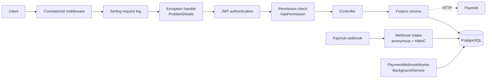
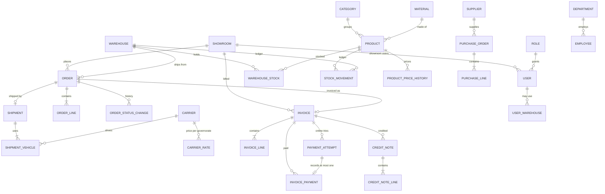
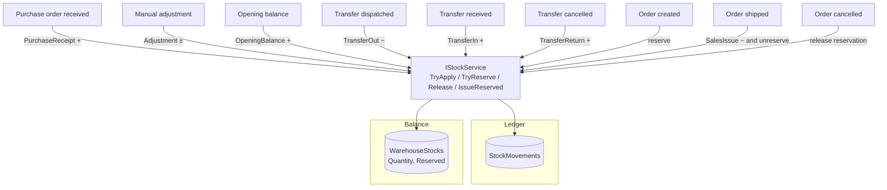
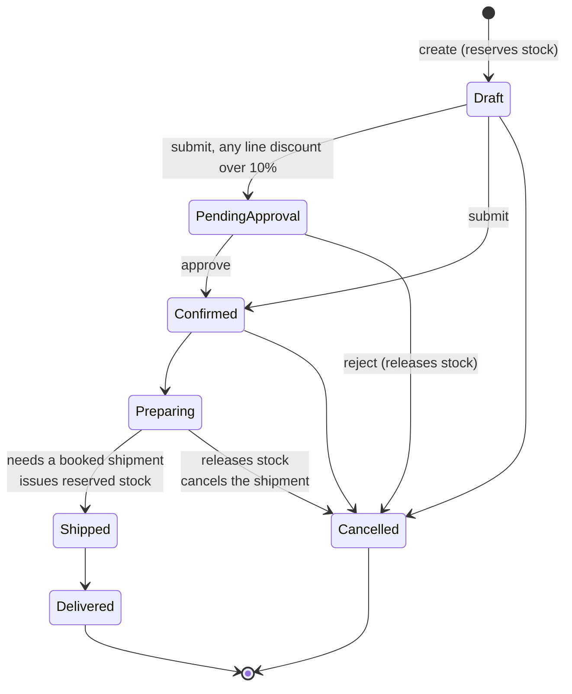
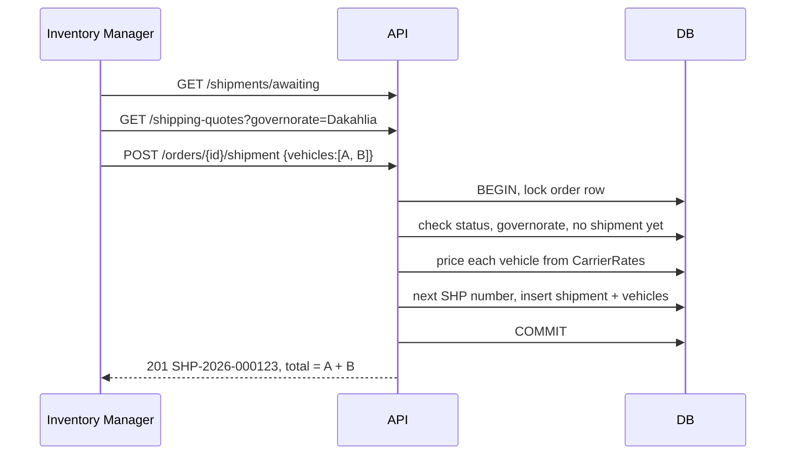
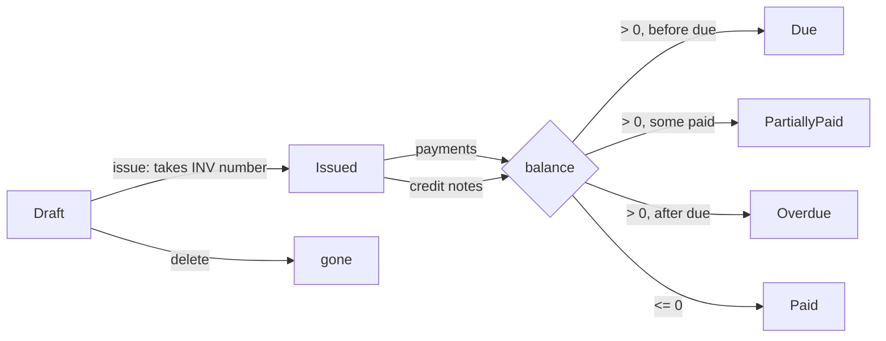
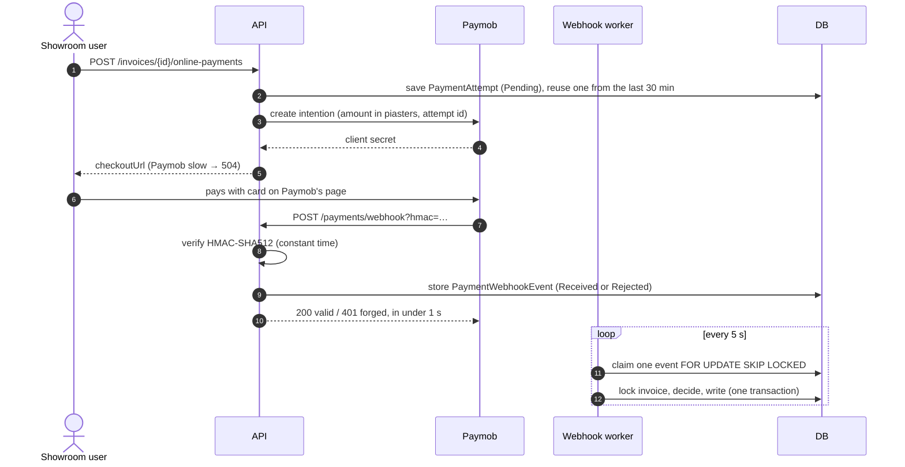
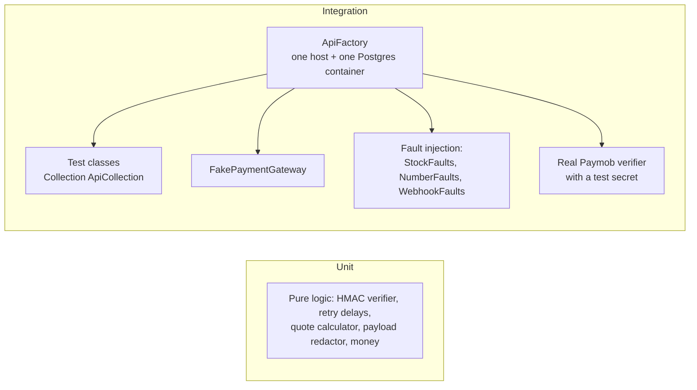

# Erp.Api — Damietta Woodworks ERP

Backend for **Damietta Woodworks**, a furniture factory in Damietta that sells wholesale to showrooms (المعارض) across Egypt. It covers the catalog, warehouses and stock, purchasing, sales orders with discount approval, shipping with company and outside trucks, invoicing with credit notes, online card payments through Paymob, and a small HR module.

The frontend is a separate Angular app (`erp.app`).

> State of `main` at commit `95e5179` (ERP-07 → ERP-17). ERP-11 is deferred, ERP-18 is in design.

---

## Contents

1. [Tech stack](#1-tech-stack)
2. [Running it](#2-running-it)
3. [Architecture](#3-architecture)
4. [Security model](#4-security-model)
5. [Data model](#5-data-model)
6. [Modules](#6-modules)
   - [Catalog](#61-catalog)
   - [Inventory](#62-inventory)
   - [Purchasing](#63-purchasing)
   - [Sales orders](#64-sales-orders)
   - [Shipping](#65-shipping)
   - [Invoicing](#66-invoicing)
   - [Online payments](#67-online-payments)
   - [HR](#68-hr)
   - [Identity](#69-identity)
7. [API reference](#7-api-reference)
8. [Errors](#8-errors)
9. [Configuration](#9-configuration)
10. [Testing](#10-testing)
11. [CI guards](#11-ci-guards)
12. [Known limits and backlog](#12-known-limits-and-backlog)

---

## 1. Tech stack

| Area | Choice |
|---|---|
| Runtime | .NET 10, ASP.NET Core controllers |
| Database | PostgreSQL 17, EF Core 10 with Npgsql |
| Auth | ASP.NET Identity users, JWT access tokens, rotating refresh tokens |
| Logging | Serilog, request logging, correlation id per request |
| PDF | QuestPDF (Community license) |
| Payments | Paymob Intention API + HMAC-signed webhooks |
| Tests | xUnit, Testcontainers (real PostgreSQL), one shared `ApiFactory` |
| Packaging | Docker, `compose.yaml` (API + Postgres) |

---

## 2. Running it

### With Docker Compose

Create `.env` next to `compose.yaml` (never commit it):

```env
DB_PASSWORD=...
JWT_KEY=...            # at least 32 random characters
ADMIN_PASSWORD=...
ADMIN_EMAIL=admin@company.com
SEED_DEMO_DATA=false
```

```bash
docker compose up --build
```

| Service | URL |
|---|---|
| API | `http://localhost:5013` |
| Swagger (non-production only) | `http://localhost:5013/swagger` |
| Liveness | `GET /health/live` |
| Readiness (checks the DB) | `GET /health/ready` |
| Postgres | `127.0.0.1:5433` |

On start the API **applies migrations**, ensures the **system roles** exist, and creates the **admin user** from `Seed:AdminEmail` / `Seed:AdminPassword`.

### Locally

```bash
dotnet user-secrets set "ConnectionStrings:DefaultConnection" "Host=localhost;Port=5433;Database=erp_db;Username=erp;Password=..." --project src/ErpDashboard.Api
dotnet user-secrets set "Jwt:Key" "..." --project src/ErpDashboard.Api
dotnet run --project src/ErpDashboard.Api
```

Payment keys also live in user-secrets locally and in environment variables in production. They never go in `appsettings*.json` or in a commit. See [Configuration](#9-configuration).

### Migrations and tests

```bash
dotnet ef migrations add <Name> --project src/ErpDashboard.Api
dotnet test ErpDashboard.slnx          # needs Docker for Testcontainers
```

---

## 3. Architecture

### Solution layout

```
src/ErpDashboard.Api
├── Auth/                      login, refresh, logout, JWT
├── Common/                    errors, paging, sorting, Money, BusinessClock, permissions
├── Controllers/               thin HTTP layer, one per resource
├── Data/
│   ├── Entities/ Enums/ Configurations/
│   ├── Seed/                  roles, permissions, fixed ids, DbSeeder
│   └── AppDbContext.cs        named query filters, soft delete
├── Features/                  business logic, grouped by domain
│   ├── Finance/Invoices       invoices, credit notes, document numbers, PDF
│   ├── Hr/                    departments, employees
│   ├── Identity/              users, roles
│   ├── Inventory/             products, categories, materials, warehouses, stock
│   ├── Payments/              online payments, webhook processing (provider-neutral)
│   ├── Purchasing/            suppliers, purchase orders
│   ├── Sales/                 showrooms, orders
│   └── Shipping/              carriers, rates, quotes, shipments
├── Infrastructure/Payments/   Paymob client + webhook verifier (only place that names the provider)
├── Middlewares/               correlation id
├── Migrations/
└── Settings/                  typed options
tests/
├── ErpDashboard.Api.UnitTests
└── ErpDashboard.Api.IntegrationTests
```

### Request pipeline



### Cross-cutting rules

| Rule | How it's enforced |
|---|---|
| **Business dates are Cairo dates**, not UTC dates | `IBusinessClock` (`Today`, `StartOfDayUtc`), backed by `TimeProvider` and `Company:TimeZone = Africa/Cairo`. It handles the DST midnight gap. A CI guard blocks `DateOnly.FromDateTime(DateTime.…)`. |
| **Money has at most 2 decimals** | Validated on every money input. `Money.ToMinorUnits` throws on more. Rounding is `AwayFromZero`, per line. |
| **Stock changes go through one service** | `IStockService` is the only writer of `WarehouseStocks` and `StockMovements`. Enforced by a CI guard. |
| **Errors are ProblemDetails** | `GlobalExceptionHandler` maps exceptions to 400/404/409/428/499/504 and adds a `code` where the client must branch. See [Errors](#8-errors). |
| **No transaction open during HTTP calls** | Payment attempts are saved before the Paymob call and updated after it. |
| **Every request has a correlation id** | Returned in `X-Correlation-ID` and in every error body. |
| **Sensitive data is never logged** | No JWTs, passwords, payment keys, checkout URLs or webhook bodies in logs. CI blocks `EnableSensitiveDataLogging`, HTTP logging and `{@…}` destructuring. |

---

## 4. Security model

### Authentication

| Item | Value |
|---|---|
| Access token | JWT, 15 minutes |
| Refresh token | 7 days, **rotated on every use** |
| Reuse detection | A rotated token used again after a short grace period revokes **all** of that user's sessions |
| Logout | `POST /api/auth/logout` (this session), `POST /api/auth/revoke-all-sessions` (all mine), `POST /api/users/{id}/logout-all` (admin) |

### Authorization: permissions, not roles

Every endpoint carries `[HasPermission("<code>")]`. Roles are just named sets of permission codes stored in `Roles.Permissions` (`text[]`).

- **Admin** always has every code. `DbSeeder` re-syncs it on each start.
- **Other system roles** get new codes through a migration (`array_append`), so roles edited in production are not overwritten.
- **Custom roles** can be created through `/api/roles`.

Two tests keep this honest:
- `EndpointPermissionTests` fails if any `api/` endpoint has no permission.
- `AnonymousEndpoints_AreOnlyTheKnownOnes` fails if a new `[AllowAnonymous]` appears without being listed on purpose.

### Role matrix

| Permission | Admin | Manager | Inventory Mgr | Accountant | Sales | Showroom User | User |
|---|:-:|:-:|:-:|:-:|:-:|:-:|:-:|
| users.* / roles.* | ✓ | | | | | | |
| showrooms.read | ✓ | ✓ | | ✓ | ✓ | | ✓ |
| showrooms.write | ✓ | ✓ | | | | | |
| showrooms.access-all | ✓ | ✓ | ✓ | ✓ | ✓ | | ✓ |
| products.read | ✓ | ✓ | ✓ | | ✓ | | ✓ |
| products.write / adjust-stock | ✓ | | ✓ | | | | |
| products.view-cost | ✓ | ✓ | ✓ | | | | |
| categories.read | ✓ | ✓ | ✓ | | ✓ | | ✓ |
| categories.write | ✓ | | ✓ | | | | |
| suppliers.read | ✓ | ✓ | ✓ | | | | |
| suppliers.write | ✓ | | ✓ | | | | |
| purchase-orders.* | ✓ | ✓ | ✓ | | | | |
| warehouses.read | ✓ | ✓ | ✓ | | ✓ | | |
| warehouses.write | ✓ | | ✓ | | | | |
| warehouses.access-all | ✓ | | | | | | |
| stock.reconcile | ✓ | | | | | | |
| orders.read | ✓ | ✓ | | ✓ | ✓ | ✓ | ✓ |
| orders.create | ✓ | ✓ | | | ✓ | | |
| orders.write / update-status | ✓ | ✓ | | | | | |
| orders.approve-discount | ✓ | ✓ | | | | | |
| invoices.read | ✓ | ✓ | | ✓ | | ✓ | |
| invoices.write / pay | ✓ | | | ✓ | | | |
| invoices.pay-online | ✓ | | | | | ✓ | |
| carriers.read | ✓ | ✓ | ✓ | | | | |
| carriers.write | ✓ | ✓ | | | | | |
| shipments.read | ✓ | ✓ | ✓ | ✓ | ✓ | | |
| shipments.book | ✓ | ✓ | ✓ | | | | |
| payments.webhooks.read | ✓ | | | | | | |
| departments.read / employees.read | ✓ | ✓ | | ✓ | | | |
| departments.write / employees.write | ✓ | | | | | | |
| employees.view-salary | ✓ | | | ✓ | | | |

### Data scope (row-level)

On top of permissions, EF Core **named query filters** limit which rows a user can see:

| Filter | Applies to | Rule |
|---|---|---|
| `QueryFilters.Showroom` | Orders, Invoices, Showrooms | Users with `showrooms.access-all` see everything. A showroom user sees only rows of **their own showroom**. Anyone else (and background workers, which have no user) sees nothing. |
| `QueryFilters.SoftDelete` | Products, Showrooms, Employees | Deleted rows are hidden. `SaveChanges` turns a delete into `IsDeleted = true`. |

Background code that must see every row opts out explicitly, for example `IgnoreQueryFilters([QueryFilters.Showroom])` in the payment webhook handler.

Warehouse access is per user (`UserWarehouses`). `warehouses.access-all` bypasses it.

### The one public endpoint that touches money

`POST /api/payments/webhook` is anonymous. Its HMAC signature is its authentication. See [Online payments](#67-online-payments).

---

## 5. Data model

### Core entities



`PaymentWebhookEvent`, `StockTransfer` and `DocumentNumberCounter` stand on their own and are described in their modules.

### Conventions

| Convention | Where | Why |
|---|---|---|
| **Snapshots** | `OrderLine.ProductName/Sku/UnitPrice`, `ShipmentVehicle.CarrierName/Price`, `Shipment.Governorate` | A later rename or price change must not rewrite history or a printed invoice. |
| **Optimistic concurrency with `xmin`** | `Order.Version` | The client sends it in `If-Match`. A missing header is 428, a stale one is 409 `order_changed`. |
| **Gapless document numbers** | Invoices `INV-yyyy-000001`, credit notes `CN-…`, shipments `SHP-…` | One counter row per series and year, incremented with `INSERT … ON CONFLICT … RETURNING` **inside** the business transaction. A rollback gives the number back. |
| **Enums stored as text** | Statuses, governorates | Safe to reorder. Exception: `PaymentMethod` is stored as an int, so new values go at the end only. |
| **Soft delete** | Products, Showrooms, Employees | Referenced by history. A CI guard blocks `ExecuteDelete` on them. |
| **Guid keys set in code** | Most entities (`ValueGeneratedNever`) | Add such entities through their `DbSet`, not through a navigation, or EF may treat them as modified rows. |

---

## 6. Modules

### 6.1 Catalog

- **Products** have SKU (normalized, unique, duplicate → 409), price, cost, reorder level, size (cm), weight (kg) and a **material** (a lookup table rather than a fixed wood type).
- **Cost price** is returned only to users with `products.view-cost`.
- **Price history**: every price change is recorded (`GET /api/products/{id}/price-history`).
- Products are soft-deleted.

### 6.2 Inventory

Stock is a **ledger**. `StockMovements` is the source of truth, and `WarehouseStocks.Quantity` is the running balance kept in step with it.



| Concept | Rule |
|---|---|
| **Available** | `Quantity − Reserved`. Orders reserve stock **at creation**, so two orders cannot sell the same chair. |
| **Shortage** | 409 with a structured body (product, requested, available), never a silent negative. |
| **Transfers** | Two steps: dispatch (`InTransit`, stock leaves A) → receive (stock enters B), or cancel (stock returns to A). Rows are locked in a stable order to avoid deadlocks. |
| **Reconciliation** | `GET /api/stock/reconciliation` compares each balance with the sum of its ledger, and `Reserved` with open orders (Draft, PendingApproval, Confirmed, Preparing). |
| **Low stock** | `GET /api/stock/low`: available at or below the product's reorder level, per warehouse. |
| **Movement history** | `GET /api/warehouses/{id}/movements`, with a running balance. |

All stock methods require an open transaction. Tests inject failures (`StockFaults`) to prove that partial work rolls back.

### 6.3 Purchasing

Suppliers and purchase orders. A purchase order is `Pending` → `Received` (stock enters through the ledger as `PurchaseReceipt`) or `Cancelled`.

### 6.4 Sales orders



| Rule | Detail |
|---|---|
| **Discount approval** | Threshold `Sales:DiscountApprovalThresholdPercent` (default 10). Approve/reject needs `orders.approve-discount`. |
| **Editing** | Only Draft orders can be edited: payment method, shipping address and **governorate** (one of Egypt's 27). |
| **Concurrency** | Every state change needs `If-Match: "<version>"`. Responses carry the new version. |
| **Status changes** | `PATCH /status` handles Preparing / Shipped / Delivered. Submit, approve, reject and cancel have their own endpoints. |
| **Invalid moves** | 409 `invalid_transition` with `currentStatus` and `allowedTransitions`. |
| **History** | Every change is stored in `OrderStatusChanges`, with who, when and a reason. |
| **Who can see** | Showroom users see only their showroom's orders (query filter). |

### 6.5 Shipping

Furniture is moved by **the company's own trucks** and by **known outside truck owners**. Both are rows in one `Carriers` table.

| Concept | Rule |
|---|---|
| **Carrier** | Name (unique), phone (required for outside carriers), active flag. Never deleted, only deactivated. |
| **Company trucks** | One fixed row (`CarrierIds.CompanyFleet`) created by the migration. It has no special area rule: it serves wherever it has a price. |
| **Rate** | One **price per vehicle per governorate**. Weight does not matter: a trip is a trip, even with an empty truck. |
| **Quote** | `GET /api/shipping-quotes?governorate=Giza` lists every active carrier with price, availability and the reason if unavailable, and returns `cheapestCarrierId`. Ties prefer company trucks, then name. |
| **Shipment** | One per order. It can use **several vehicles from different carriers**. Each vehicle stores its carrier name and price at booking time. Tracking number `SHP-yyyy-000001`. |
| **Booking** | `POST /api/orders/{id}/shipment` for Confirmed or Preparing orders that have a governorate. It locks the order row, so booking, cancelling and shipping cannot interleave. |
| **Awaiting list** | `GET /api/shipments/awaiting`: orders ready to ship, without prices, for the Inventory Manager (who cannot open orders themselves). |
| **Order link** | `Shipped` requires a booked shipment (`shipment_required`). Cancelling the order cancels its shipment. |



### 6.6 Invoicing

| Concept | Rule |
|---|---|
| **Sources** | Manual (Draft → Issue) or one click from a Shipped/Delivered order (`POST /api/invoices/from-order/{orderId}`). |
| **Lines** | Line discount, then tax on the discounted amount. Tax and totals are rounded per line. Default tax 14%. |
| **Shipping lines** | From an order, each shipment vehicle becomes its own line `Shipping – {carrier} ({SHP-…})` at **0% tax**, priced at booking time. |
| **Numbers** | `INV-yyyy-000001`, gapless, taken only when the invoice is issued. |
| **Payments** | Partial payments allowed, never above the balance. Manual methods: Cash, CreditCard (counter). `Online` is written only by the payment processor. |
| **Payment status** | Computed, not stored: `Due`, `PartiallyPaid`, `Paid`, `Overdue` (Overdue wins when the due date has passed with a balance). |
| **Credit notes** | Instead of cancelling an issued invoice. Per invoice line, capped at that line's remaining net. Numbered `CN-…`. The balance may go negative (refund due). |
| **PDF** | `GET /api/invoices/{id}/pdf`. |



### 6.7 Online payments

A showroom user pays an issued invoice by card on Paymob's hosted page. **Money is recorded only from a signed webhook, never from the redirect back to the site**, because anyone can open a URL.



**What the worker writes**

| What happened | Attempt | Invoice | Event |
|---|---|---|---|
| Paid, amount fits the balance | Succeeded | + `Online` payment | Processed |
| Card declined | Failed | – | Processed |
| Paid more than due, invoice cancelled, or wrong amount/currency | NeedsRefund | – | Processed |
| Same callback again | no change | – | Ignored (duplicate) |
| Pending, refund or void callback | no change | – | Ignored |
| Money for an unknown attempt | – | – | NeedsReview |
| Error while processing | no change | rolled back | retry with backoff, Failed after 8 tries |

**Guarantees**

- **Paid once**: `InvoicePayment.PaymentAttemptId` is unique, and the invoice row is locked like a manual payment.
- **Retry without double work**: the handler runs inside a savepoint. A failure rolls back its writes but keeps the event lock.
- **The API never stops for a bad webhook**: the worker catches everything per iteration.
- **Provider-neutral core**: `IPaymentGateway` and `IPaymentWebhookVerifier` live in `Features/Payments`. Paymob code lives only in `Infrastructure/Payments/Paymob`, and CI enforces it.
- **Admin view**: `GET /api/payments/webhook-events` (filters: status, signature, invoice, attempt, dates, transaction id). The details view **redacts** names, emails, phones and tokens in the stored payload.

Verified end to end in the Paymob sandbox: success, decline, and a cash payment made while the customer was on the checkout page.

### 6.8 HR

Departments and employees, soft-deleted. Salary is returned only with `employees.view-salary`.

### 6.9 Identity

- Users have one role, an optional showroom (for showroom users) and a list of warehouses they may use.
- Roles are editable sets of permission codes. System roles cannot be deleted or renamed, and Admin's permissions cannot be edited.
- `GET /api/profile/me` returns the current user and their role.

---

## 7. API reference

All routes are under `/api`. Every non-anonymous route needs `Authorization: Bearer <jwt>`.

### Auth and profile

| Method | Route | Permission |
|---|---|---|
| POST | `/auth/login` | anonymous |
| POST | `/auth/refresh` | anonymous |
| POST | `/auth/logout` | signed in |
| POST | `/auth/revoke-all-sessions` | signed in |
| GET | `/profile/me` | signed in |

### Identity

| Method | Route | Permission |
|---|---|---|
| GET | `/users`, `/users/{id}` | users.read |
| POST / PUT / DELETE | `/users`, `/users/{id}` | users.write |
| POST | `/users/{id}/logout-all` | users.write |
| GET | `/users/{id}/warehouses` | users.read |
| PUT | `/users/{id}/warehouses` | users.write |
| GET | `/roles`, `/roles/{id}`, `/roles/permissions` | roles.read |
| POST / PUT / DELETE | `/roles`, `/roles/{id}` | roles.write |

### Catalog and inventory

| Method | Route | Permission |
|---|---|---|
| GET | `/products`, `/products/{id}`, `/products/{id}/price-history` | products.read |
| POST / PUT / DELETE | `/products`, `/products/{id}` | products.write |
| GET | `/categories`, `/categories/{id}` | categories.read |
| POST / PUT / DELETE | `/categories`, `/categories/{id}` | categories.write |
| GET | `/materials` | products.read |
| POST / PUT | `/materials`, `/materials/{id}` | products.write |
| GET | `/warehouses`, `/warehouses/{id}` | warehouses.read |
| POST / PUT | `/warehouses`, `/warehouses/{id}` | warehouses.write |
| GET | `/warehouses/{id}/stock` | products.read |
| POST | `/warehouses/{id}/stock/adjust` | products.adjust-stock |
| GET | `/warehouses/{id}/movements` | warehouses.read |
| POST | `/stock/transfers`, `/stock/transfers/{id}/receive`, `/stock/transfers/{id}/cancel` | products.adjust-stock |
| GET | `/stock/transfers`, `/stock/transfers/{id}` | warehouses.read |
| GET | `/stock/low` | products.read |
| GET | `/stock/reconciliation` | stock.reconcile |

### Purchasing

| Method | Route | Permission |
|---|---|---|
| GET | `/suppliers`, `/suppliers/{id}` | suppliers.read |
| POST / PUT / DELETE | `/suppliers`, `/suppliers/{id}` | suppliers.write |
| GET | `/purchaseorders`, `/purchaseorders/{id}` | purchase-orders.read |
| POST / PUT | `/purchaseorders`, `/purchaseorders/{id}` | purchase-orders.write |
| PATCH | `/purchaseorders/{id}/status` | purchase-orders.update-status |

### Sales

| Method | Route | Permission | If-Match |
|---|---|---|:-:|
| GET | `/showrooms`, `/showrooms/{id}` | showrooms.read | |
| POST / PUT / DELETE | `/showrooms`, `/showrooms/{id}` | showrooms.write | |
| GET | `/orders`, `/orders/{id}`, `/orders/{id}/history` | orders.read | |
| POST | `/orders` | orders.create | |
| PUT | `/orders/{id}` | orders.write | ✓ |
| POST | `/orders/{id}/submit` | orders.create | ✓ |
| POST | `/orders/{id}/approve`, `/orders/{id}/reject` | orders.approve-discount | ✓ |
| PATCH | `/orders/{id}/status` | orders.update-status | ✓ |
| POST | `/orders/{id}/cancel` | orders.write | ✓ |

### Shipping

| Method | Route | Permission |
|---|---|---|
| GET | `/carriers`, `/carriers/{id}` | carriers.read |
| POST / PUT | `/carriers`, `/carriers/{id}` | carriers.write |
| PUT / DELETE | `/carriers/{id}/rates/{governorate}` | carriers.write |
| GET | `/shipping-quotes?governorate=` | carriers.read |
| POST | `/orders/{id}/shipment` | shipments.book |
| GET | `/orders/{id}/shipment` | shipments.read |
| GET | `/shipments/awaiting` | shipments.book |

### Finance and payments

| Method | Route | Permission |
|---|---|---|
| GET | `/invoices`, `/invoices/{id}`, `/invoices/{id}/pdf` | invoices.read |
| POST / PUT / DELETE | `/invoices`, `/invoices/{id}` (drafts) | invoices.write |
| PATCH | `/invoices/{id}/issue` | invoices.write |
| POST | `/invoices/from-order/{orderId}` | invoices.write |
| POST | `/invoices/{id}/credit-notes` | invoices.write |
| POST | `/invoices/{id}/payments` | invoices.pay |
| POST | `/invoices/{id}/online-payments` | invoices.pay-online |
| POST | `/payments/webhook?hmac=` | anonymous, HMAC, max 64 KB |
| GET | `/payments/webhook-events`, `/payments/webhook-events/{id}` | payments.webhooks.read |

### HR

| Method | Route | Permission |
|---|---|---|
| GET | `/departments`, `/departments/{id}` | departments.read |
| POST / PUT / DELETE | `/departments`, `/departments/{id}` | departments.write |
| GET | `/employees`, `/employees/{id}` | employees.read |
| POST / PUT / DELETE | `/employees`, `/employees/{id}` | employees.write |

### Lists

List endpoints share `PageQuery`: `page`, `pageSize`, `search`, `sortBy`, `sortDir`. They return `PagedResult<T>` (`items`, `page`, `pageSize`, `total`). Sorting goes through a whitelist (`SortMap`) with a stable tie-breaker.

---

## 8. Errors

Every error is RFC 9110 ProblemDetails with `correlationId`. Some carry a `code` the client should branch on.

| Status | `code` | When |
|---|---|---|
| 400 | – | Validation. `errors` holds field-level messages, for example `vehicles[1].carrierId`. |
| 401 | – | Missing/expired token, bad refresh token, forged webhook |
| 403 | – | Missing permission |
| 404 | – | Not found, **or outside your showroom scope** |
| 409 | `order_changed` | `If-Match` version is stale |
| 409 | `invalid_transition` | Order status move not allowed. Includes `currentStatus` and `allowedTransitions`. |
| 409 | `shipment_required` | Marking an order Shipped without a booked shipment |
| 409 | `not_bookable` | Booking a shipment for an order that is not Confirmed/Preparing |
| 409 | `governorate_missing` | Booking for an order with no governorate |
| 409 | `already_booked` | The order already has a shipment |
| 409 | – | Unique violation (duplicate SKU, carrier name, …), stock shortage (structured body), concurrent update |
| 413 | – | Webhook body over 64 KB |
| 428 | – | `If-Match` missing on an order change |
| 499 | – | The client went away |
| 504 | – | The payment provider did not answer in time |

---

## 9. Configuration

| Key | Default | Notes |
|---|---|---|
| `ConnectionStrings:DefaultConnection` | – | Secret |
| `Jwt:Key`, `Jwt:Issuer`, `Jwt:Audience` | – | Key is secret |
| `Jwt:DurationInMinutes` | 15 | Access token |
| `Jwt:ExpiryDays` | 7 | Refresh token |
| `Seed:AdminEmail`, `Seed:AdminPassword` | – | First admin, secret password |
| `Seed:DemoData` | false | Demo data seeding (backlog) |
| `Cors:AllowedOrigins:0` | – | Angular app origin |
| `Company:TimeZone` | Africa/Cairo | Business dates |
| `Finance:DefaultTaxRate` | 14 | Percent |
| `Finance:DefaultDueDays` | 30 | Invoice due date |
| `Sales:DiscountApprovalThresholdPercent` | 10 | Above this, orders need approval |
| `Payments:Provider` | "" | `paymob` or empty (online payments disabled) |
| `Payments:Paymob:SecretKey`, `PublicKey`, `HmacSecret`, `IntegrationId` | – | **Secrets**: user-secrets locally, environment variables in production |
| `Payments:Paymob:ApiBaseUrl` | https://accept.paymob.com | |
| `Payments:Paymob:CheckoutBaseUrl` | https://eg.checkout.paymob.com | |
| `Payments:Paymob:NotificationUrl`, `RedirectionUrl` | – | Public URL of `/api/payments/webhook` and of the frontend |
| `Payments:Paymob:TimeoutSeconds` | 10 | |
| `Payments:Webhooks:Enabled` | true | Background worker on/off (off in tests) |
| `Payments:Webhooks:PollSeconds` | 5 | Idle wait between polls |

---

## 10. Testing



| Practice | Why |
|---|---|
| **Real PostgreSQL** through Testcontainers | Locks, `SKIP LOCKED`, `xmin`, unique and check constraints behave as in production. |
| **One shared host** (`ApiFactory`), all integration tests in one collection | Fast and avoids two hosts fighting over one database. Tests create their own data with unique names, so they never depend on order. |
| **Fault injection through decorators**, registered once in the factory | Proves rollbacks: stock, document numbers, webhook handling. |
| **Race tests** | Two requests at once: shipping twice, booking twice, invoicing twice, the same webhook processed by two workers. |
| **Facts that depend on global data are unit-tested** | For example "which carrier is cheapest" is tested on the calculator, not through the shared database. |
| **Workers are driven directly** | The webhook worker is disabled in tests, and tests call `ProcessNextAsync` until the queue is empty. |

---

## 11. CI guards

`.github/workflows/ci.yml` runs on every PR and push to `main`:

| Guard | Blocks |
|---|---|
| Risky logging | `EnableSensitiveDataLogging`, HTTP logging, `{@…}` destructuring |
| Soft-delete entities | `ExecuteDelete` on Products, Employees, Showrooms |
| Stock writes | Any write to stock tables outside `StockService` |
| Business dates | Building a `DateOnly` from a UTC `DateTime` outside `BusinessClock` |
| Payment provider | The word "paymob" anywhere in `src` outside its own folder, the provider switch and appsettings |
| Locked restore | `dotnet restore --locked-mode` |
| Tests ran | Fails if zero tests executed |

---

## 12. Known limits and backlog

| Item | Notes |
|---|---|
| **ERP-11** | Deferred |
| **ERP-18: confirm and pay** | In design. Needs payment on the order (today payments attach to invoices only), a step after payment success, refunds/voids and email. Waiting on a decision about how far existing code may be extended. |
| Change or cancel a shipment on its own | Today a shipment is cancelled only with its order. |
| Negotiated shipping price at booking | Today the price always comes from the rate table. |
| Automatic refunds | `NeedsRefund` attempts are refunded by hand in the Paymob dashboard. |
| Refund/void callbacks | Stored and ignored, not processed. |
| Demo data seeder | `Seed:DemoData` exists in config, the seeder does not yet. |
| Tests to add | Last-admin protection counts all admins, order details id mapping. |
| Webhook payload retention | Stored forever today, with personal data (redacted only in the API). |
